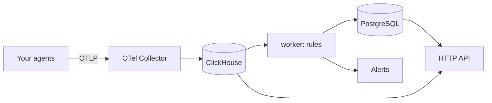

# Rolda

Open source, self-hosted observability for AI agents in production.

Rolda receives OpenTelemetry traces from your agents, detects failures
(errors, tool loops, slow or token-hungry runs), alerts your team, points at
the probable cause and turns confirmed failures into eval cases.

> **Status: v0.1, pre-release.** The MVP is built and tested, but it has not
> been validated on a real agent yet. Read [docs/STATUS.md](docs/STATUS.md)
> for what is proven and what is not before relying on it.

## What it does

- **Ingests** OTLP traces (gRPC and HTTP) through the standard
  OpenTelemetry Collector into ClickHouse.
- **Detects** with deterministic rules: span errors, tool loops, and
  outliers in latency and tokens, per trace and per span.
- **Records incidents** in PostgreSQL, one per trace and rule, so
  reprocessing never duplicates them.
- **Explains** each incident with the path from the root span to the
  culprit and a signature that groups similar failures.
- **Alerts** through a generic webhook, Slack, Google Chat or Teams.
- **Collects labels** from humans (and optionally a judge) and exports
  them as an eval file in JSONL.
- **Serves an HTTP API** to list incidents, read a trace's behavior and
  record labels.

It reads behavior: spans, tools, status, tokens and durations. Prompt and
response content is not stored or used. A span's error message is kept in the
incident and shown in alerts and the API, unredacted, so keep secrets out of
your error messages.



## Quick start

You need Docker with Compose, and [uv](https://docs.astral.sh/uv/) with
Python 3.12 or newer to run the tests and tools.

```bash
git clone https://github.com/eudesgccunha/rolda.git
cd rolda/deploy/compose
cp .env.example .env     # then set real passwords and a long API token
docker compose --profile app up -d --build --wait
curl http://127.0.0.1:8000/health   # liveness
curl http://127.0.0.1:8000/ready    # checks both databases
```

This starts ClickHouse, PostgreSQL, the Collector (OTLP on `127.0.0.1:4317`
and `4318`), the worker and the API. `docker compose up` without
`--profile app` starts only the infrastructure. If port 8000 is taken, set
`ROLDA_API_HOST_PORT`.

Point your agent's OTLP exporter at `http://127.0.0.1:4318/v1/traces`. See
[docs/instrumentation.md](docs/instrumentation.md) for the attributes Rolda
reads. To try it without an agent, run the simulated one:

```bash
uv run --no-project \
  --with opentelemetry-sdk \
  --with opentelemetry-exporter-otlp-proto-http \
  python examples/support_agent/run.py
```

Its model is simulated and its tools are real code. See
[examples/support_agent/README.md](examples/support_agent/README.md).

## Using it

List incidents (the token is `ROLDA_API_TOKEN` from your `.env`):

```bash
curl -H "Authorization: Bearer $ROLDA_API_TOKEN" \
  "http://127.0.0.1:8000/incidents?limit=10"
```

Label an incident, export the labeled set and measure the judge:

```bash
uv run python -m rolda.entrypoints.cli label <trace_id> <rule> failure --reason "real outage"
uv run python -m rolda.entrypoints.cli export-evals --out evals.jsonl
ANTHROPIC_API_KEY=... uv run python -m rolda.entrypoints.cli judge-eval --evals evals.jsonl
```

The CLI needs the same `POSTGRES_*` and `CLICKHOUSE_*` variables as the
worker in the environment. `judge-eval` refuses to run with fewer than 30
labeled cases, because kappa on a small set means nothing.

## Configuration

Everything comes from the environment. Secrets never go in the repository.

| Variable | Default | Meaning |
|---|---|---|
| `CLICKHOUSE_USER`, `CLICKHOUSE_PASSWORD` | required | ClickHouse credentials |
| `POSTGRES_USER`, `POSTGRES_PASSWORD` | required | PostgreSQL credentials |
| `ROLDA_API_TOKEN` | required for the API | Bearer token, at least 16 characters |
| `ROLDA_API_HOST`, `ROLDA_API_PORT` | `127.0.0.1`, `8000` | API bind address |
| `ROLDA_API_DOCS` | `false` | Serve the OpenAPI docs |
| `ROLDA_WINDOW_SECONDS`, `ROLDA_INTERVAL_SECONDS` | `300`, `60` | Worker first-run lookback and period |
| `ROLDA_MAX_CATCHUP_SECONDS`, `ROLDA_CHUNK_SECONDS` | `86400`, `3600` | Longest outage the worker catches up on, and the size of each catch-up step |
| `ROLDA_CLICKHOUSE_HOST/PORT`, `ROLDA_POSTGRES_HOST/PORT` | loopback | Database addresses |
| `ROLDA_JUDGE_MODEL` | `claude-haiku-5-5` | Model for `judge-eval` |
| `ROLDA_STATUS_HOST`, `ROLDA_STATUS_PORT` | `127.0.0.1`, `9100` | Worker `/healthz` and `/metrics` |
| `ROLDA_POSTGRES_POOL_SIZE` | `5` | Most PostgreSQL connections per process |
| `ROLDA_SHARD_COUNT`, `ROLDA_SHARD_INDEX` | `1`, `0` | Split traces between workers. The index can be `auto` (pod ordinal) |

Alert channels. Each is optional and must be an http or https URL. These
URLs are secrets, and Rolda never logs them.

| Variable | Channel |
|---|---|
| `ROLDA_WEBHOOK_URL` | Generic JSON webhook |
| `ROLDA_SLACK_WEBHOOK_URL` | Slack incoming webhook |
| `ROLDA_GOOGLE_CHAT_WEBHOOK_URL` | Google Chat incoming webhook |
| `ROLDA_TEAMS_WEBHOOK_URL` | Teams Workflows webhook (Adaptive Card) |

Detection thresholds. The defaults come from simulated data, so check them
on your own traces. Lower values catch more and raise more false alarms.

| Variable | Default | Meaning |
|---|---|---|
| `ROLDA_Z_THRESHOLD` | 3.5 | Shared robust z-score threshold |
| `ROLDA_Z_LATENCY` | shared | Whole-trace latency |
| `ROLDA_Z_SPAN_LATENCY` | 3.0 | One slow model or tool call |
| `ROLDA_Z_TOKENS` | shared | Tokens of a whole trace |
| `ROLDA_Z_SPAN_TOKENS` | shared | Tokens of one model call |
| `ROLDA_MIN_SAMPLES` | 30 | History needed before an outlier rule runs |
| `ROLDA_TOOL_LOOP_REPEATS` | 3 | Same tool and arguments this many times is a loop |

## Kubernetes

Kustomize manifests for the API, the sharded worker and a collector with a disk
queue are in [`deploy/k8s`](deploy/k8s/README.md). They do not include the
databases. See ADR 0020 for what was tested and what was not.

## Security

- Every Compose port is bound to `127.0.0.1`. The OTLP receiver and the
  databases have no network authentication, so keep them off public
  networks.
- The API needs a bearer token and refuses to start without one. Put TLS in
  front of it before exposing it.
- Trace content is untrusted input. It may contain prompt injection, so it
  is stored and shown as data, never run, and it reaches the judge only as
  delimited data with a validated answer.
- Queries are parameterized. Images and CI actions are pinned by digest or
  commit.

To report a vulnerability, read [SECURITY.md](SECURITY.md).

## Development

```bash
uv sync --locked
uv run ruff format --check . && uv run ruff check .
uv run mypy && uv run bandit -c pyproject.toml -r src
uv run pytest                    # unit tests
uv run pytest -m integration     # needs the Compose stack and its env vars
```

Read [CONTRIBUTING.md](CONTRIBUTING.md), the
[Code of Conduct](CODE_OF_CONDUCT.md) and [AGENTS.md](AGENTS.md) (the
rules for coding agents, which humans can follow too).

## Documentation

- [docs/STATUS.md](docs/STATUS.md): what works, what is proven, what is next
- [docs/SPEC.md](docs/SPEC.md): the MVP plan ([Portuguese original](docs/SPEC.pt-BR.md))
- [docs/adr/](docs/adr/README.md): architecture decisions
- [docs/instrumentation.md](docs/instrumentation.md): instrumenting an agent

## License

Rolda is licensed under the [Apache License 2.0](LICENSE). It includes an
express patent grant. Contributions are accepted under the same license.
