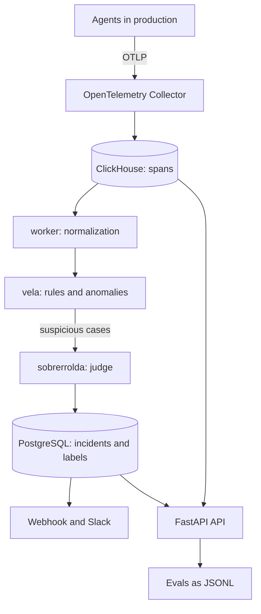

# Rolda: MVP specification (v0.1)

> English translation of [SPEC.pt-BR.md](SPEC.pt-BR.md), the original plan.
> What was built, what was verified and where the plan changed is in
> [STATUS.md](STATUS.md).

## 1. Goal

Receive traces from any agent through OpenTelemetry (OTLP), detect
failures, alert, point at the probable cause and turn confirmed failures
into evaluation cases (evals).

Product references: LiteLLM Lens (trace analysis) and Moyai (monitoring
agents in production).

## 2. Scope

| In the MVP | Out of the MVP |
|---|---|
| OTLP ingestion (gRPC and HTTP) | Own web interface |
| Trace queries through an API | Own instrumentation SDK |
| Detection by rules and statistics | Blocking actions in real time |
| Alerts by webhook and Slack | Multi-tenant, SSO and RBAC |
| Probable cause per incident | Import from Langfuse or LangSmith |
| Configurable LLM judge (optional) | Helm chart (next phase) |
| Eval export as JSONL | Managed cloud services |

## 3. Architecture



The stage names are Portuguese: `vela` is the detection stage, and
`sobrerrolda` is the judge, a second reviewer that is called only when the
rules see something odd.

### Decisions and reasons

| Decision | Reason | Cost |
|---|---|---|
| Standard Collector at the entrance | No own protocol | One more service |
| ClickHouse for spans | Analytical queries at volume | Operation and schema |
| PostgreSQL for state | Updates and transactions | A second database |
| One codebase, two processes | Simple `api` and `worker` | They scale together |
| Ports and adapters | Swap judge, database and alert | More interfaces |
| LiteLLM is not a dependency | Smaller attack surface | One adapter per API |

There is no queue in the MVP: the worker reads ClickHouse by time window,
with some slack for late spans, and writes incidents idempotently (key
`trace_id` + `rule`). Evaluate a queue once there are measurements.

The ClickHouse schema must be versioned as SQL in the repository, with
`create_schema: false` in the exporter.

### Target layout

```text
rolda/
├── deploy/compose/        # compose.yaml, collector and SQL
├── docs/adr/              # architecture decisions
├── src/rolda/
│   ├── traces/            # domain model and normalization
│   ├── detection/         # vela
│   ├── judge/             # sobrerrolda
│   ├── incidents/         # probable cause and labels
│   ├── evals/             # export
│   ├── alerts/            # webhook and Slack
│   └── entrypoints/       # api and worker
└── tests/
```

## 4. Detection (vela)

| Rule | Initial criterion (configurable) |
|---|---|
| `span_error` | Span with an error status |
| `tool_loop` | Same tool and arguments 3 times in a trace |
| `latency_outlier` | Robust z-score (median and MAD) above 3.5 |
| `token_outlier` | Same calculation on tokens per trace |

The thresholds are starting points, to calibrate with real data. Outlier
rules need at least 30 samples per agent and ignore a MAD of zero. If the
tool arguments are not captured, `tool_loop` compares only the name and
marks the finding as low confidence.

## 5. Probable cause

1. Find the first span with an error, or the first one that triggers the
   rule.
2. Build the path from the root to that span.
3. Group incidents by the signature `agent + rule + operation + error`.

The result is a hypothesis, shown with its evidence.

## 6. Judge (sobrerrolda)

| Phase | Strategy | Use |
|---|---|---|
| 1 | `DisabledJudge` (default) | Human review and label collection |
| 2 | OpenAI-compatible API | Local model (for example Ollama) or hosted |
| 3 | Amazon Bedrock | For those already on AWS |

Rules:

- Structured, validated output: `failure`, `false_alarm` or `uncertain`,
  with a justification. An invalid answer becomes `uncertain`.
- Prefer a model from a different family than the evaluated agent.
- Compare with human labels before trusting it. Start with 50 to 100
  cases and require Cohen's kappa above 0.6.
- Keep the cases used to tune the prompt apart from those used to measure.
- Set a ceiling on calls per hour to control cost.

## 7. Milestones

Each milestone becomes one or more small tasks for the coding agent.

| Milestone | Deliverable | Acceptance criterion |
|---|---|---|
| M0 | Repository and CI | All checks pass on GitHub |
| M1 | Compose with Collector and ClickHouse | A test span can be queried |
| M2 | Domain model and normalization | Tests with real fixtures |
| M3 | Rules and worker | Reprocessing does not duplicate incidents |
| M4 | Incidents, probable cause and alerts | The webhook receives the alert |
| M5 | Labels and eval export | JSONL validated by a test |
| M6 | Judge adapter | Kappa measured and published |

Suggested first request to the coding agent:

> Read `AGENTS.md` and `docs/SPEC.md`. Plan milestone M1 and wait for my
> approval before writing code.

## 8. Security and privacy

- Compose ports bound to `127.0.0.1` by default.
- Authentication required before exposing OTLP or the API on a network.
- Prompt and response capture off by default; redact before storing.
- Configurable retention (TTL) in ClickHouse.
- Trace content is untrusted input, the judge included.

## 9. Open decisions

- License (suggestion: Apache-2.0, because it includes a patent grant).
- Interface: temporary Grafana or an own UI in v0.2.
- Sampling strategy for high volumes.
