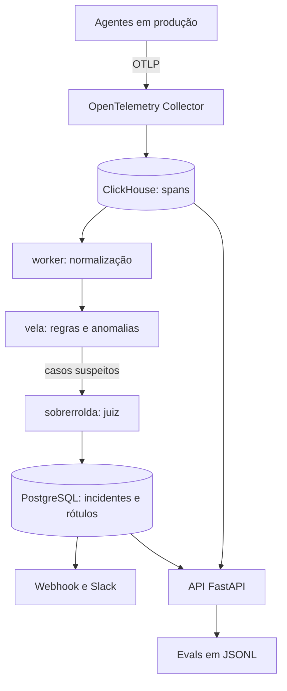

# Rolda: especificação do MVP (v0.1)

## 1. Objetivo

Receber traces de qualquer agente via OpenTelemetry (OTLP), detectar
falhas, alertar, apontar a causa provável e transformar falhas confirmadas
em casos de avaliação (evals).

Referências de produto: LiteLLM Lens (análise de traces) e Moyai
(monitoramento de agentes em produção).

## 2. Escopo

| No MVP | Fora do MVP |
|---|---|
| Ingestão OTLP (gRPC e HTTP) | Interface web própria |
| Consulta de traces via API | SDK de instrumentação próprio |
| Detecção por regras e estatística | Bloqueio de ações em tempo real |
| Alertas por webhook e Slack | Multi-tenant, SSO e RBAC |
| Causa provável por incidente | Importação de Langfuse ou LangSmith |
| Juiz LLM configurável (opcional) | Helm chart (próxima fase) |
| Exportação de evals em JSONL | Serviços gerenciados em nuvem |

## 3. Arquitetura



### Decisões e motivos

| Decisão | Motivo | Custo |
|---|---|---|
| Collector padrão na entrada | Não criar protocolo próprio | Mais um serviço |
| ClickHouse para spans | Consultas analíticas em volume | Operação e schema |
| PostgreSQL para estado | Atualizações e transações | Segundo banco |
| Um código, dois processos | `api` e `worker` simples | Escala conjunta |
| Portas e adaptadores | Trocar juiz, banco e alerta | Mais interfaces |
| Sem LiteLLM como dependência | Menor superfície de ataque | Um adaptador por API |

Sem fila no MVP: o worker lê o ClickHouse por janelas de tempo, com uma
folga para spans atrasados, e grava incidentes de forma idempotente
(chave `trace_id` + `rule`). Avaliar uma fila quando houver medição.

O schema do ClickHouse deve ser versionado em SQL no repositório, com
`create_schema: false` no exporter.

### Estrutura alvo

```text
rolda/
├── deploy/compose/        # compose.yaml, collector e SQL
├── docs/adr/              # decisões de arquitetura
├── src/rolda/
│   ├── traces/            # modelo de domínio e normalização
│   ├── detection/         # vela
│   ├── judge/             # sobrerrolda
│   ├── incidents/         # causa provável e rótulos
│   ├── evals/             # exportação
│   ├── alerts/            # webhook e Slack
│   └── entrypoints/       # api e worker
└── tests/
```

## 4. Detecção (vela)

| Regra | Critério inicial (configurável) |
|---|---|
| `span_error` | Span com status de erro |
| `tool_loop` | Mesma ferramenta e argumentos 3 vezes no trace |
| `latency_outlier` | z-score robusto (mediana e MAD) acima de 3,5 |
| `token_outlier` | Mesmo cálculo sobre tokens por trace |

Os limiares são pontos de partida, a calibrar com dados reais. Regras de
outlier exigem ao menos 30 amostras por agente e ignoram MAD igual a zero.
Se os argumentos da ferramenta não forem capturados, `tool_loop` compara só
o nome e marca o achado como de baixa confiança.

## 5. Causa provável

1. Localizar o primeiro span com erro ou o primeiro que dispara a regra.
2. Montar o caminho da raiz até esse span.
3. Agrupar incidentes pela assinatura `agente + regra + operação + erro`.

O resultado é uma hipótese, exibida com as evidências.

## 6. Juiz (sobrerrolda)

Analogia: um segundo revisor, chamado só quando a ronda vê algo estranho.

| Fase | Estratégia | Uso |
|---|---|---|
| 1 | `DisabledJudge` (padrão) | Revisão humana e coleta de rótulos |
| 2 | API compatível com OpenAI | Modelo local (ex.: Ollama) ou hospedado |
| 3 | Amazon Bedrock | Quem já usa AWS |

Regras:

- Saída estruturada e validada: `failure`, `false_alarm` ou `uncertain`,
  com justificativa. Resposta inválida vira `uncertain`.
- Preferir um modelo de família diferente da usada pelo agente avaliado.
- Comparar com rótulos humanos antes de confiar. Começar com 50 a 100
  casos e exigir kappa de Cohen acima de 0,6.
- Separar os casos usados para ajustar o prompt dos usados para medir.
- Definir teto de chamadas por hora para controlar custo.

## 7. Marcos

Cada marco vira uma ou mais tarefas pequenas para o agente de código.

| Marco | Entrega | Critério de aceite |
|---|---|---|
| M0 | Repositório e CI | Todos os checks passam no GitHub |
| M1 | Compose com Collector e ClickHouse | Span de teste consultável |
| M2 | Modelo de domínio e normalização | Testes com fixtures reais |
| M3 | Regras e worker | Reprocessar não duplica incidentes |
| M4 | Incidentes, causa provável e alertas | Webhook recebe o alerta |
| M5 | Rótulos e exportação de evals | JSONL validado por teste |
| M6 | Adaptador do juiz | Kappa medido e publicado |

Primeiro pedido sugerido ao Claude Code:

> Leia `AGENTS.md` e `docs/SPEC.md`. Planeje o marco M1 e espere minha
> aprovação antes de escrever código.

## 8. Segurança e privacidade

- Portas do Compose ligadas apenas a `127.0.0.1` por padrão.
- Autenticação obrigatória antes de expor o OTLP ou a API na rede.
- Captura de prompts e respostas desligada por padrão; redigir antes de
  gravar.
- Retenção configurável (TTL) no ClickHouse.
- Conteúdo de traces é entrada não confiável, inclusive para o juiz.

## 9. Decisões em aberto

- Licença (sugestão: Apache-2.0, por incluir concessão de patentes).
- Interface: Grafana temporário ou UI própria na v0.2.
- Estratégia de amostragem para volumes altos.
